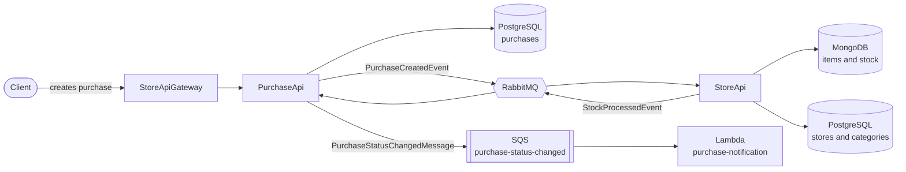

-232F3E?style=for-the-badge&logo=amazonaws&logoColor=white)

# PurchaseApi

ASP.NET Core purchase API that integrates asynchronously with the StoreApi (stock deduction) and triggers status-change notifications through an SQS queue consumed by an AWS Lambda. AWS services run locally with Floci. Clients reach it through the StoreApiGateway.

## Flow

1. The client creates a purchase through the StoreApiGateway, which forwards it to the PurchaseApi. The PurchaseApi saves it with status `Pending`.
2. The PurchaseApi publishes a `PurchaseCreatedEvent` to RabbitMQ (MassTransit).
3. The StoreApi consumes the event and deducts stock idempotently.
4. The StoreApi replies with a `StockProcessedEvent`.
5. The PurchaseApi consumes the reply and updates the purchase to `Confirmed` or `Rejected` (with a `RejectionReason`).
6. The PurchaseApi publishes a message to the `purchase-status-changed` SQS queue.
7. The `purchase-notification` Lambda is triggered by the queue and logs the notification.



## Tech stack

- ASP.NET Core with AutoMapper
- PostgreSQL and EF Core (Npgsql), with migrations
- RabbitMQ with MassTransit
- Amazon SQS and AWS Lambda (.NET 8), emulated by Floci
- Docker and Docker Compose

## Solution structure

| Project | Responsibility |
| --- | --- |
| Api | Controllers, configuration and message consumers |
| Application | Use cases and mappings (AutoMapper) |
| Communication | Requests and responses |
| Domain | Entities, enums, interfaces and messages |
| Exception | Domain and application exceptions |
| Infrastructure | EF Core, repositories and messaging (RabbitMQ and SQS) |
| PurchaseNotificationFunction | Lambda that consumes the notification queue |

The `AddApplication` and `AddInfrastructure(builder.Configuration)` extensions register each layer's dependencies.

## Purchase status

| Status | Meaning |
| --- | --- |
| Pending | Purchase created, waiting for the stock result |
| Confirmed | Stock reserved successfully |
| Rejected | Stock refused; the reason is stored in `RejectionReason` |

## Endpoints

| Method | Route | Description |
| --- | --- | --- |
| POST | /api/purchases | Creates a purchase (status `Pending`); returns 201 with the `Location` header |
| GET | /api/purchases | Lists purchases |
| GET | /api/purchases/{id} | Returns one purchase; 404 if it does not exist |

Enums are serialized as text. Request example:

```json
{
  "itemID": "6ad4def84c3f10514043a630",
  "paymentType": "CreditCard",
  "quantity": 1,
  "total": 1
}
```

`paymentType` accepts `Cash`, `CreditCard`, `DebitCard` and `EletronicTransfer`.

Response example:

```json
{
  "id": "99fc9c5a-779b-4f8e-88ef-2ab2ab9dde87",
  "itemID": "6ad754ebd9129bd198370cd3",
  "paymentType": "CreditCard",
  "quantity": 1,
  "total": 1,
  "status": "Confirmed",
  "rejectionReason": null
}
```

## Messages

**PurchaseCreatedEvent** and **StockProcessedEvent** travel through RabbitMQ and use the `Contracts.Events` namespace in both APIs.

**PurchaseStatusChangedMessage** is published to the SQS queue as JSON, with the status as text:

```json
{
  "PurchaseId": "99fc9c5a-779b-4f8e-88ef-2ab2ab9dde87",
  "Status": "Confirmed",
  "Reason": null,
  "OccurredAt": "2026-10-20T11:48:08.3957134Z"
}
```

The queue name is configured in `Aws:NotificationQueueName` (default: `purchase-status-changed`).

## Running

Prerequisites: Docker, Docker Compose and the AWS CLI.

The PurchaseApi, the StoreApi and the StoreApiGateway have their own compose files and communicate through the shared `shared-net` network. RabbitMQ comes up with the StoreApi compose.

1. Start the StoreApi compose (RabbitMQ, database and API).
2. Start the PurchaseApi compose (`purchases-db`, `floci` and `purchases-api`).
3. Start the StoreApiGateway compose, if a client such as the web front end needs to reach the APIs.

| Service | Port |
| --- | --- |
| PurchaseApi | 8081 |
| PostgreSQL (purchases-db) | 5432 |
| Floci (local AWS) | 4566 |
| StoreApi | 8080 |
| RabbitMQ | 5672 (management UI on 15672) |
| StoreApiGateway | 8082 |
| purchase-web (Next.js) | 3000 |

The environment variables live in a `.env` file next to the compose file. Docker Compose reads it to fill the `${...}` placeholders (database and RabbitMQ credentials). A `.env.example` lists the variable names without values.

## Local AWS setup (Floci)

The commands below use PowerShell. Set dummy credentials:

```powershell
$env:AWS_ACCESS_KEY_ID="test"
$env:AWS_SECRET_ACCESS_KEY="test"
$env:AWS_DEFAULT_REGION="us-east-1"
```

### 1. Create the queue

```powershell
aws --endpoint-url http://localhost:4566 --region us-east-1 sqs create-queue --queue-name purchase-status-changed
```

### 2. Package the Lambda

From the `PurchaseNotificationFunction` folder:

```powershell
dotnet publish -c Release -r linux-x64 --self-contained false -o publish
tar -a -c -f function.zip -C publish .
```

The project must target `net8.0` to match the `dotnet8` runtime.

### 3. Create the function

```powershell
aws --endpoint-url http://localhost:4566 --region us-east-1 lambda create-function --function-name purchase-notification --runtime dotnet8 --handler "PurchaseNotificationFunction::PurchaseNotificationFunction.Function::FunctionHandler" --role arn:aws:iam::000000000000:role/lambda-role --zip-file fileb://function.zip
```

### 4. Connect the queue to the function

```powershell
aws --endpoint-url http://localhost:4566 --region us-east-1 lambda create-event-source-mapping --function-name purchase-notification --event-source-arn arn:aws:sqs:us-east-1:000000000000:purchase-status-changed --batch-size 1
```

The event source mapping is what connects the queue to the Lambda: Floci polls the queue and, for each message, calls `FunctionHandler` with an `SQSEvent`. To check that only one mapping exists (two would cause duplicate notifications):

```powershell
aws --endpoint-url http://localhost:4566 --region us-east-1 lambda list-event-source-mappings --function-name purchase-notification
```

## Verifying the flow

Queue and messages:

```powershell
aws --endpoint-url http://localhost:4566 --region us-east-1 sqs list-queues
aws --endpoint-url http://localhost:4566 --region us-east-1 sqs get-queue-attributes --queue-url http://localhost:4566/000000000000/purchase-status-changed --attribute-names ApproximateNumberOfMessages
```

After creating a purchase, the Lambda container log (created by Floci, with a name like `floci-purchase-notification-...`) shows the notification:

```powershell
docker ps --format "table {{.Names}}"
docker logs <lambda-container-name> --tail 20
```

Example output (the log text is in Portuguese, as written by the function):

```
Notificação: a compra 815dec32-7ff3-4544-b334-9b665063b86d foi CONFIRMADA.
```

If nothing reaches the queue, check the PurchaseApi logs: SQS send failures are logged (without breaking the purchase) with the message "Falha ao enviar a notificação da compra".

